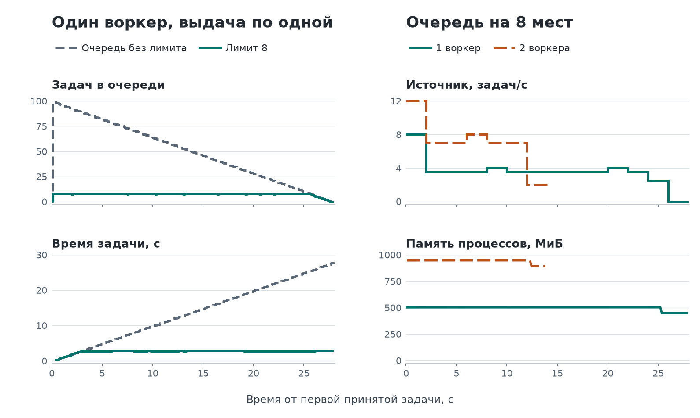

# MaLLM Очередь задач в RabbitMQ

Когда очередь на 8 мест заполнена, источник ждёт и повторяет отправку. Один воркер обрабатывал около 3,6 задачи/с, два — 7,3. Каждый режим проверили 4 раза по 100 задач на RabbitMQ 4.1.8. Все 1600 задач дали результат.

| Опыт | Макс. в очереди (Ready) | Принято, задач/с | Обработано, задач/с | Память источника / воркеров, МиБ | Время для 95 % задач, с |
|---|---:|---:|---:|---:|---:|
| 1 воркер, оба лимита сняты | 0 | 4296,57 | 3,63 | 43,1 / 449,1 | 26,05 |
| 1 воркер, выдача по одной, очередь без лимита | 99 | 5507,01 | 3,59 | 43,2 / 448,2 | 26,42 |
| 1 воркер, 8 мест, выдача по одной | 8 | 3,58 | 3,59 | 54,2 / 448,5 | 2,81 |
| 2 воркера, 8 мест, выдача по одной | 8 | 7,27 | 7,27 | 54,0 / 893,5 | 1,66 |

Ready показывает, сколько сообщений ждут выдачи. В первом режиме брокер сразу передал воркеру все 100 задач, поэтому в Ready было 0. Воркер обрабатывал их по одной. В режиме с выдачей по одной до 99 задач ждали в очереди.

Глубину очереди проверяли примерно раз в 150 мс. В этих 16 прогонах максимум по опросам совпал с отдельной проверкой по событиям RabbitMQ. В таблице приведены медианы четырёх повторов каждого режима.

